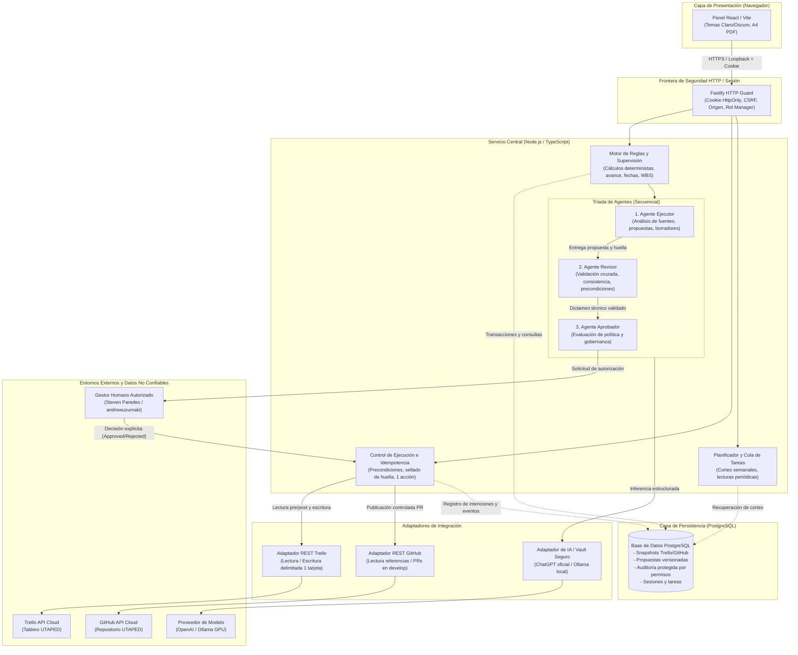
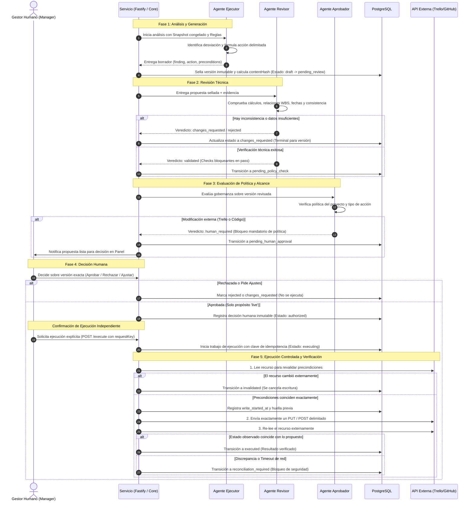
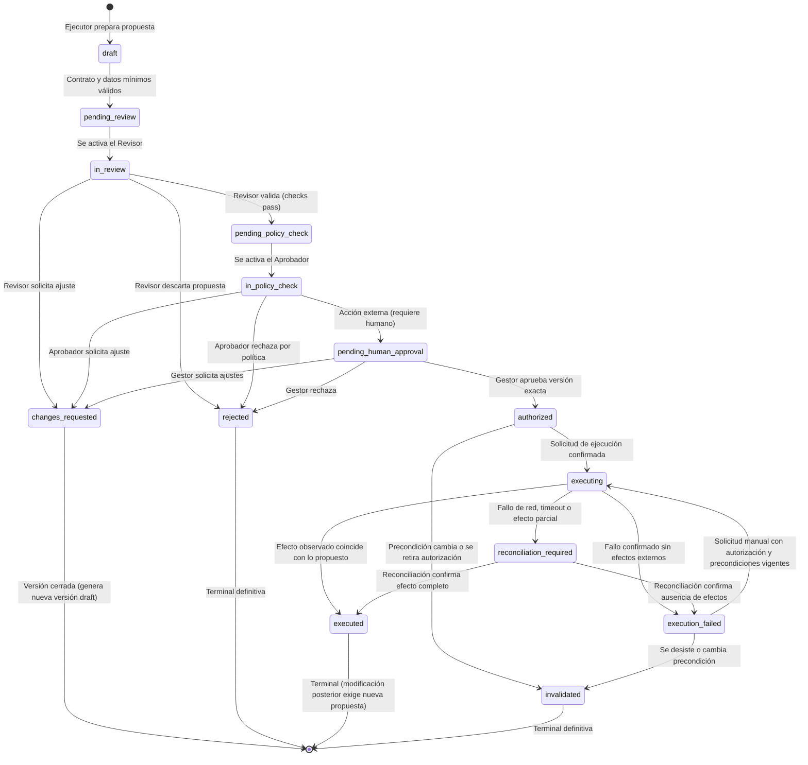
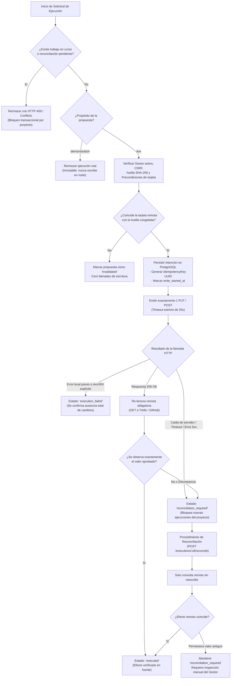

# Diagramas y Especificación de Arquitectura del Agente

Documento técnico que detalla la arquitectura de software, la orquestación secuencial de la tríada de agentes, los límites estrictos de operación y las contingencias frente a fallos del sistema **Dev Project Agent** para la supervisión de proyectos de software (caso UTAPED).

---

Los diagramas resumen el flujo de propuestas externas; los reportes internos usan reglas deterministas y no recorren una aprobación de IA. Las transiciones exactas dependen del módulo. La protección de auditoría corresponde al rol ordinario y no equivale a inmutabilidad frente a un administrador.

## 1. Diagrama de Componentes y Fronteras de Confianza

Este diagrama ilustra la arquitectura general del sistema, los límites de seguridad y la separación entre la lógica determinista del servicio y los modelos de lenguaje (IA).

---

## 2. Diagrama de Secuencia: Orquestación de los Tres Agentes

Muestra el ciclo de vida completo desde la detección de una desviación hasta la verificación de la ejecución o rechazo, demostrando que **la IA nunca tiene permiso de ejecución directa**.

---

## 3. Diagrama de Estados: Ciclo de Vida de Propuestas

Representa las transiciones permitidas por el motor de estados. Cualquier intento de salto arbitrario de estado es rechazado por el backend.

---

## 4. Diagrama de Contingencias, Idempotencia y Reconciliación

Explica cómo reacciona el sistema ante caídas del servidor, fallos de red y concurrencia.

---

## 5. Límites Críticos del Agente (System Boundaries)

1. **Monoproyecto y Aislamiento**:
   - Diseñado estrictamente para supervisar un único proyecto operativo (**UTAPED**).
   - No tiene acceso ni conexión a la base de datos de producción de UTAPED ni a datos académicos reales; solo supervisa el tablero de Trello y el repositorio de Git/GitHub.

2. **Propósito Inmutable (`demonstration` vs `live`)**:
   - Toda propuesta nace como `demonstration` por defecto. Si se crea como tal, **nunca** puede cambiar a `live` ni emitir escrituras reales en servicios externos, independientemente de la configuración del entorno.
   - El propósito `live` requiere configuración expresa del operador (`TRELLO_WRITES_ENABLED=true` y credenciales separadas) y confirmación explícita del gestor.

3. **Sin Autonomía de Modificación Externa**:
   - La IA **carece de herramientas para ejecutar comandos shell o peticiones de red arbitrarias**.
   - Toda salida generada por un modelo (JSON) es tratada como datos no confiables y validada sintáctica y semánticamente por esquemas estrictos de TypeScript/Fastify.
   - La IA no puede autorizar una propuesta ni declarar que una tarea ha sido aceptada formalmente.

4. **Acción Atómica y Unitaria**:
   - Una propuesta de Trello solo puede afectar a **una única tarjeta** y a una familia de atributos específica (vencimiento, inicio/fin, asignados, prioridad o estado).
   - Está prohibida la aprobación o ejecución de lotes masivos para prevenir impactos colaterales imprevistos.

5. **No Concurrencia Distribuida (Ausencia de 2PC)**:
   - PostgreSQL y las APIs de Trello/GitHub no comparten una transacción ACID distribuida.
   - El servicio asume que puede existir una carrera externa si un usuario edita Trello simultáneamente en el navegador; por ello, siempre realiza una verificación de precondiciones inmediatamente previa al envío y una lectura de confirmación posterior.

6. **Publicación en GitHub Delimitada**:
   - Las propuestas de código solo preparan ramas de trabajo aisladas (`agent/<proposal-id>-v<version>`) con pull requests en estado borrador hacia `develop`.
   - El agente **jamás** realiza commits directos en `main` ni ejecuta merges automáticos; la integración final siempre corresponde a un humano.

---

## 6. Estrategia de Contingencias y Recuperación

| Escenario de Contingencia | Detección / Condición | Comportamiento del Sistema y Recuperación |
| :--- | :--- | :--- |
| **Corte de red o Timeout durante escritura (Trello/GitHub)** | La petición HTTP no responde en el plazo configurado o arroja `ECONNRESET`. | El trabajo pasa a `reconciliation_required`. Se prohíben reintentos automáticos a ciegas. El gestor ejecuta una consulta de reconciliación (`POST /reconcile`) que solo lee para verificar si la acción impactó o no. |
| **Reinicio del servidor con trabajos pendientes** | El proceso se apaga abruptamente y vuelve a iniciar. | Al arrancar, el servicio escanea `execution_jobs`. Si `write_started_at` ya había ocurrido, marca `reconciliation_required`. Si el fallo ocurrió antes de emitir escritura, marca `failed` de forma segura. |
| **Agotamiento de cuota o indisponibilidad de IA** | OpenAI/Ollama devuelve error 429, 503 o cuota expirada. | El `Run` del agente falla registrando el error técnico. La propuesta **permanece en su estado previo** (`pending_review` o `pending_policy_check`). Nunca se aprueba automáticamente ni se omite la revisión. |
| **Desincronización de Precondiciones (Edición concurrente)** | Un miembro del equipo cambia una fecha en Trello mientras el gestor aprobaba. | Al intentar ejecutar, el servicio lee la tarjeta y compara la huella. Al detectar discordancia, cancela la escritura, marca la propuesta como `invalidated` y exige crear una nueva versión basada en la realidad actual. |
| **Caída o desconexión de PostgreSQL** | Error de conexión con la base de datos local. | El servidor responde 503 (Servicio no disponible). Fastify rechaza transiciones. Las operaciones de red externas no se inician si no se puede persistir la intención previamente. |
| **Retirada de Autorización por el Gestor** | El gestor decide retirar su visto bueno antes de ejecutar. | Se invoca `POST /withdraw`. La versión pasa inmediatamente a `invalidated`, conservando la auditoría conservada de la decisión previa y del motivo de retirada. |
